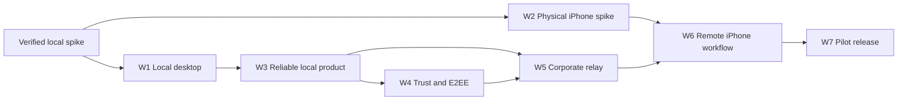

# Development waves — Mac + iPhone MVP

Updated: 2026-11-21. Planning mode: vertical MVP slices, explicitly selected by the user. This roadmap replaces the old phase-only status summary; historical product scope and acceptance IDs remain in [MVP-PLAN](planning/MVP-PLAN.md) and [UI-SPEC](planning/UI-SPEC.md). [ADR-12](STACK.md) supersedes the Go stack.

## Baseline: what is already proven

Rust host/server/native core; independent macOS tmux and agent service lifetimes; real local desktop tabs and live output; same-runtime reconnect; leased local input; Unicode/paste/Enter; selection in Claude; unsent Codex draft continuity. Evidence: [desktop](P0-DESKTOP-VERIFICATION.md), [runtime](P0-RUNTIME-VERIFICATION.md), [CLI](P0-CLI-VERIFICATION.md).

This is a local development spike. P0 is still open: physical iPhone usability and E2EE/key-store feasibility have not passed. Model response/approval-task completion, production installation, durable operations, remote transport and release readiness are not established by the existing tests.

## Operating model

Each wave follows **investigate → accept decisions/ADR → decompose → implement small vertical slices → verify → review → record evidence and re-estimate**. The entire product has a direction now; only the next wave receives detailed executable tickets. Later investigations consume actual results rather than frozen assumptions.

A wave is done only when its user scenario and failure cases pass, not when its files compile. Each task must name its contracts, touched files, dependencies, negative cases and runnable checks. Parallel work is allowed only with stable interfaces and no conflicting file ownership. Do not use wave numbers as automatic permission to publish, enroll devices or deploy infrastructure.

## Wave map

| Wave | User-visible result | Dependencies / scope | Exit evidence |
|---|---|---|---|
| W1 — Local desktop workflow | Create Claude/Codex in a selected project; new tab opens; readable font, zoom, expanded/fullscreen terminal | Current spike. Native workspace picker, fixed launch profiles, durable creation/reconciliation, owner-authorized resize, preferences | Both provider launch flows in the native app; cancel/failure/double-submit/lost-reply/crash cases; no duplicate runtime; zoom/resize without process loss or cross-tab input |
| W2 — iPhone feasibility | Demonstrate that the chosen shell can provide usable terminal input on a physical iPhone | Can start alongside W1 when Xcode/signing/device access exist. Bundled real terminal fixtures and a native input recorder, no plaintext remote runtime path | Ukrainian/English keyboard/IME, paste, selection, scrolling, cursor with keyboard, rotation, suspend/foreground; explicit Tauri continue/replace-shell decision |
| W3 — Reliable local product | Open the installed Mac app and work without manually preparing a temporary lab | W1; W2 findings must not contradict shared client contracts. Durable session history/rename/stop, stable agent/tmux installation, diagnostics, restored tabs, explicit controller policy | Native install/restart/recovery; precise exit/unreachable states; user configuration preserved; independent second-client races; slow viewer cannot stall another session or grow memory without bound |
| W4 — Endpoint trust and E2EE feasibility | A paired test endpoint exchanges authenticated encrypted traffic and rejects an untrusted endpoint | Stable W3 session/control contracts; can research earlier. Rust crypto selection, Keychain, pairing transcript, key pinning, fresh connection epochs, compatibility vectors | Tampered/replayed/key-substituted frames rejected; secrets confined to endpoints; key-lock/reset behavior; opaque relay harness; closes remaining P0 cryptographic gate |
| W5 — Corporate remote access | A trusted client reaches its own Mac through the company relay | W3 + W4. Corporate OIDC/enrollment, host directory, PostgreSQL, TLS and outbound tunnels, authorization expiry/revocation, bounded encrypted relay | Two identities isolated; relay logs/traffic contain no known terminal plaintext; relay restart/network partition/revocation; local Mac operation survives relay outage |
| W6 — End-to-end iPhone workflow | Start on Mac, continue the same runtime on iPhone, return control to Mac | W2 + W5 + stable desktop ownership UI. Mobile session/create/pairing/device flows, explicit handoff, keyboard-aware resize, fresh-redraw reconnect | Physical device over real E2EE relay; Wi-Fi/mobile-network switch, background/lock/foreground, stale owner rejection, no input replay; UI-SPEC M1–M10 |
| W7 — Installable pilot | A small internal cohort can install, recover and use the product with documented support boundaries | W6; release/security review and signing/distribution access. Signed Mac/iOS artifacts, server operations, upgrade/rollback, safe uninstall, bounded metadata observability | A01–A15 release matrix; installation/recovery exercised by another person; no unresolved critical/high authorization, key-trust, process-loss or duplicate-input defect |

## Dependencies and permitted concurrency

W2 is an early feasibility lane, not an excuse to delay platform evidence until the relay is finished. Crypto research and IdP/signing discovery may begin early; remote runtime access cannot ship or be used for real work before trust/E2EE gates. If only one developer is active, finish one implementation slice at a time and use parallelism for independent research or device setup.

The old P0–P5 names are scope categories, not a second execution schedule: W1 covers part of P1/P2; W2 covers the phone portion of P0; W3 completes local P1/P2 hardening; W4 covers the security part of P0 and prerequisite P3 work; W5 covers P3; W6 covers P4; W7 covers P5. Completed spikes stay completed; this does not restart the project.

## Wave 1 intended scope

Outcome: create and use a session entirely from the Mac interface. Detailed technical choices remain subject to INV-001 and its accepted ADR.

- Native folder picker with cancel semantics; bounded, typed workspace identity; project path/name shown before launch.
- Host-resolved Claude/Codex profiles with readiness errors; provider authentication and approval/sandbox defaults remain on the Mac.
- Durable request identity and reconcile-before-retry across spawn/acknowledgement crashes. An uncertain result is shown explicitly; reconnect cannot silently launch a new process.
- Create dialog with pending/error states, one successful runtime opening one tab, focus restored to the new terminal, session retained when its tab closes.
- Explicit readable font size, zoom/reset controls and keyboard shortcuts; expandable workspace and native fullscreen; presentation changes do not remount a live attachment.
- Layout/zoom derives rows and columns. Only the acknowledged owner may change the tmux runtime size; spectators change only their local display. Resize is coalesced and fenced across detach/reconnect/control changes.
- Persist non-secret view preferences separately from host-authoritative session state. No split panes, terminal recording, Shell profile or mobile feature scope in W1.

### Wave 1 acceptance gate

| Case | Required result |
|---|---|
| Native create for each provider | Correct project and installed executable; new runtime ID and selected tab |
| Cancel picker / unavailable CLI / inaccessible folder | No process created; clear recovery action |
| Double submission / lost reply / agent crash around spawn | One operation reconciles to at most one runtime; no automatic respawn |
| Font increase/decrease/reset, expand, fullscreen | Readable input cursor and predictable grid; input/focus stay with the same session |
| Spectator resize / stale lease | Host rejects runtime mutation; other owner dimensions stay stable |
| Close/reopen, app restart, agent restart | Runtime identity survives where tmux survives; UI restores preferences and reports state honestly |
| Two sessions and output pressure | No cross-session input/output leakage; bounded queues and responsive control |
| Actual native acceptance | Real Mac WebView + real Claude/Codex startup and safe input/menu tests, with screenshot and machine-readable identity evidence |

Relevant existing acceptance IDs: A01, A02, A04 (local ownership subset), A06 (agent subset), A11, A13, A15; D1–D4, D7, D9. Remote/device portions remain later gates, not implicitly passed here.

## Wave 1 planning status

The user selected vertical MVP slices (--mvp). Formal research is in progress against source baseline 91d9695. Technical decisions and executable tasks will be published after research and plan validation. GitHub Issues track accepted tasks; feature branches and PRs carry implementation changes. Private local workflow artifacts and receipts are not release source.

## Scheduling and external inputs

Do not treat the historical 10–17.5 engineer-week estimate as a fresh forecast: it predates the current Rust spike and does not account for the unresolved device/security gates. Estimate W1 after its checked decomposition, record actual cycle time, and re-estimate the next wave at every exit. Do not divide effort mechanically by the number of agents.

Before W2: physical iPhone, supported Xcode, signing team/device access. Before W4/W5: Keychain behavior, corporate IdP and enrollment policy, server hosting/domain/TLS ownership, revocation requirements. Before W7: distribution/signing ownership, pilot participants and review availability. These are tracked dependencies; they do not block local W1 planning.

## Scope after pilot

Linux host/desktop and Android follow pilot feedback. Structured agent chat, approval cards, diff views, recordings and split terminals need separate product decisions. Keep extension boundaries without building those capabilities now.
