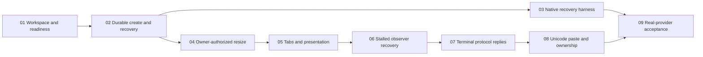

# Wave 1 — local desktop delivery plan

Architecture: [accepted ADR-13](decisions/ADR-13-local-desktop-workflow.md). Product direction: [seven-wave roadmap](ROADMAP.md). Tracking: [W1 milestone](https://github.com/serhii-nochevnyi/remote-sessions/milestone/1).

The outcome is a Mac workflow that creates Claude Code or Codex in a chosen project, opens one live terminal tab, survives interrupted creation without duplicate processes, and supports readable zoom, expanded layout and owner-authorized resize. SQLite state stays on the internal Mac disk; source and project folders may remain on KINGSTON.

## Delivery order

Nine vertical slices form eight execution waves **within product wave W1**. These numbers do not replace the product roadmap's W1–W7. All implementation remains pending.

| Execution wave | Ticket / outcome | Needs | Risk |
|---|---|---|---|
| 1 | [T-01-01 — Choose a workspace and check provider readiness](https://github.com/serhii-nochevnyi/remote-sessions/issues/2) | Baseline | high |
| 2 | [T-01-02 — Create and recover one durable local session](https://github.com/serhii-nochevnyi/remote-sessions/issues/3) | [T-01-01](https://github.com/serhii-nochevnyi/remote-sessions/issues/2) | high |
| 3 | [T-01-03 — Reproduce desktop recovery in isolated native jobs](https://github.com/serhii-nochevnyi/remote-sessions/issues/4) | [T-01-02](https://github.com/serhii-nochevnyi/remote-sessions/issues/3) | high |
| 3 | [T-01-04 — Resize one live terminal with an effect-time lease](https://github.com/serhii-nochevnyi/remote-sessions/issues/5) | [T-01-02](https://github.com/serhii-nochevnyi/remote-sessions/issues/3) | high |
| 4 | [T-01-05 — Navigate tabs and restore terminal presentation](https://github.com/serhii-nochevnyi/remote-sessions/issues/6) | [T-01-04](https://github.com/serhii-nochevnyi/remote-sessions/issues/5) | medium |
| 5 | [T-01-06 — Recover a stalled observer without blocking the terminal](https://github.com/serhii-nochevnyi/remote-sessions/issues/7) | [T-01-05](https://github.com/serhii-nochevnyi/remote-sessions/issues/6) | high |
| 6 | [T-01-07 — Keep terminal protocol replies out of user input](https://github.com/serhii-nochevnyi/remote-sessions/issues/8) | [T-01-06](https://github.com/serhii-nochevnyi/remote-sessions/issues/7) | high |
| 7 | [T-01-08 — Paste one Unicode draft under the live owner lease](https://github.com/serhii-nochevnyi/remote-sessions/issues/9) | [T-01-07](https://github.com/serhii-nochevnyi/remote-sessions/issues/8) | high |
| 8 | [T-01-09 — Verify both real desktop workflows and document W1 acceptance](https://github.com/serhii-nochevnyi/remote-sessions/issues/10) | [T-01-08](https://github.com/serhii-nochevnyi/remote-sessions/issues/9), [T-01-03](https://github.com/serhii-nochevnyi/remote-sessions/issues/4) | medium |

01-03 and 01-04 can proceed in parallel after 01-02: their declared files do not overlap. 01-09 requires both the harness and finished workflow, so the graph intentionally joins these two paths. Before starting 01-09, integrate the 01-03 harness through the phase branch and synchronize it into the 01-08-based checkout; verify both dependency implementations are present. Other slices share implementation boundaries and proceed in dependency order. Each first usable slice owns its immediate failure proofs; the later harness improves reproducibility rather than postponing safety testing.

## Review and branch contract

Every ticket requires review of its current PR head. Automatic merging is disabled (`auto_merge: off`); no ticket has preauthorized merges. Product implementation starts in separate ticket branches. Parent dependencies determine the initial PR base; final integration into main also requires an explicit merge decision.

Phase integration: `feat/local-desktop-creation-and-terminal-ergonomics`.

| Ticket | Planned branch | Initial PR base |
|---|---|---|
| T-01-01 | `feat/choose-a-workspace-and-check-provider-re` | `feat/local-desktop-creation-and-terminal-ergonomics` |
| T-01-02 | `feat/create-and-recover-one-durable-local-ses` | `feat/choose-a-workspace-and-check-provider-re` |
| T-01-03 | `feat/reproduce-desktop-recovery-in-isolated-n` | `feat/create-and-recover-one-durable-local-ses` |
| T-01-04 | `feat/resize-one-live-terminal-with-an-effect` | `feat/create-and-recover-one-durable-local-ses` |
| T-01-05 | `feat/navigate-tabs-and-restore-terminal-prese` | `feat/resize-one-live-terminal-with-an-effect` |
| T-01-06 | `feat/recover-a-stalled-observer-without-block` | `feat/navigate-tabs-and-restore-terminal-prese` |
| T-01-07 | `feat/keep-terminal-protocol-replies-out-of-us` | `feat/recover-a-stalled-observer-without-block` |
| T-01-08 | `feat/paste-one-unicode-draft-under-the-live-o` | `feat/keep-terminal-protocol-replies-out-of-us` |
| T-01-09 | `feat/verify-both-real-desktop-workflows-and-d` | `feat/paste-one-unicode-draft-under-the-live-o` |

## Acceptance and evidence

Each issue contains scoped checks, expected negative cases and native acceptance. Test files named in those plans are future deliverables, not claims that the tests already exist or pass.

- Workspace selection and readiness perform no launch. Both internal and accessible KINGSTON folders are exercised through the native picker.
- The first create-capable PR proves stable operation identity, at-most-one launch, double submission, lost reply and crash reconciliation. An unknown outcome permits status checks; it never silently retries a spawn.
- Resize checks live ownership at the effect boundary, including expiry with no successor. Layout, font and tab changes preserve the attachment and process identity.
- Tab navigation and reordering restore correctly after relaunch. A stalled viewer cannot block healthy output, and protocol replies cannot become user input.
- Unicode paste remains bound to its initiating lease, including uncertain commit and ownership handoff.
- The final slice records a fresh native Mac build with both real providers, process/runtime identities and screenshots. Controlled drafts and menus submit zero model prompts. Existing P0 reports remain historical evidence.

Executor handoff includes local checks and the owning native acceptance. The coordinator publishes each PR, then checks CI and review on that exact head; an executor never waits for CI on an unpublished PR. W1 completion requires all acceptance cases and recorded evidence, not merely green compilation.

## Planning verification

The accepted investigation and ADR passed Gate 1. Typed phase research, planner output and the independent checker have verified receipts and artifact digests; the checker returned `pass`. Gate 2 generated the dependency graph successfully. Graph warnings identify planned new files, dependencies on code without shared file ownership, and the intentional final join. Each new path has an owning slice; the harness and evidence consume the completed workflow. There is no file conflict or cycle.

Canonical executable plans, validation maps, graph and dispatch receipts remain local under `.planning/`; GitHub Issues are their reviewable projection. Package versions proposed by research remain provisional until registry metadata and locked builds are checked during implementation. This planning PR does not prove W1 behavior and does not merge or start the implementation.

Re-estimate after the first delivered slice using observed effort and review time. The next implementation entry is T-01-01.
