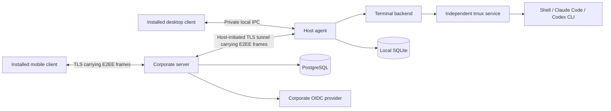

# Architecture baseline

Version: 0.2 · 2026-11-21

## 1. Scope and principles

Build a company-operated remote terminal product with desktop session tabs and mobile access. Run the employee's real installed Claude Code, Codex CLI, and shell in their existing workstation environment. The phone is a client; the corporate server is an identity/directory/relay service; neither executes the coding task.

Confirmed MVP platforms: Mac host/desktop and iPhone client. Linux workstation/desktop and Android client support remain architectural extension targets after the pilot, not MVP deliverables. Linux hosting of the corporate server is unaffected.

Confirmed invariants:

1. Execution belongs to the employee's Mac/Linux host and OS account.
2. Closing a view, disconnecting a phone, or restarting the relay does not terminate a runtime.
3. Only the same corporate user can access their enrolled hosts, using independently paired client keys.
4. Remote session content and commands are encrypted end to end between client and host agent.
5. The host operates as a user-level background service. No privileged root execution broker.
6. Desktop local use does not depend on corporate-server availability after local setup.
7. Terminal and future structured-agent backends share lifecycle concepts but retain different interaction contracts.

## 2. Components

| Component | Owns | Does not own |
|---|---|---|
| Desktop/mobile UI | Views, navigation, keyboard, terminal rendering | Process lifetime or permission decisions |
| Native client core | Pairing, trusted keys, E2EE, reconnect, narrow UI bridge | CLI credentials or host filesystem |
| Host agent | Session API, authorization, input ownership, engine adapter, local metadata | Corporate identity provider |
| tmux service | Long-lived PTYs, programs, terminal state | Product identity, E2EE, mobile UI |
| Corporate server | OIDC integration, enrolled host directory, access grants, revocation distribution, ciphertext relay, metadata audit | Session plaintext, CLI credentials, terminal reconstruction |

Initial deployment is one modular server application plus PostgreSQL, and one host-agent binary plus an independent tmux service. Server control and relay modules can be separated later without changing the client/session contract. A separate custom session-supervisor binary is unnecessary for MVP.

### Implementation stack

| Layer | Baseline | Rationale |
|---|---|---|
| Host and corporate server | Go | Shared networking, contracts, operational tooling |
| Desktop and mobile shell | Tauri 2 | Installed clients with bundled UI and native integrations |
| UI | React + TypeScript | Shared session state/components; distinct desktop/mobile layouts |
| Terminal renderer | xterm.js | Existing emulator rather than custom terminal rendering |
| Client native core | Rust within Tauri; small Swift plugins where required; Kotlin deferred with Android | E2EE, key-store access, pairing, platform lifecycle |
| Session engine | Dedicated tmux instance | Persistence across view and network-agent restarts |
| Storage | SQLite on host; PostgreSQL on server | Local authority and a small central registry |
| Transport | Local Unix socket; remote outbound WSS | No incoming workstation ports; deployment through a company gateway |

Tauri's mobile support is documented, but it does not prove terminal usability on a phone. Phase 0 must test real iPhone input, keyboard viewport, selection, and reconnect. If that gate fails, replace only the mobile shell with React Native plus a bundled terminal WebView and reuse the protocol/native-core contracts. Do not build both mobile implementations in parallel. [Tauri overview](https://v2.tauri.app/start/), [native mobile plugins](https://v2.tauri.app/develop/plugins/develop-mobile/).

## 3. Product model and ownership

| Entity | Purpose |
|---|---|
| Host | Workstation identity, owner, last-seen availability |
| Workspace | Registered local directory and launch environment |
| Session | Stable user-facing record: name, workspace, backend, history of runtime identities |
| Runtime | One actual execution attempt and its terminal process; a new launch receives a new runtime ID |
| View | One device's attachment or tab; disposable and device-local |
| Input lease | Host-controlled authority to send user input and resize, with an ownership epoch |

The host is authoritative for actual runtimes. Server presence is an observation, never proof of process exit. A session's identity is not a PID, a tab index, a tmux display name, or an agent's conversation ID.

Desktop tab order and open/closed views are per-device preferences. Session names and workspaces are host metadata, visible to all paired owner devices through E2EE. Phones present a list instead of reproducing the desktop tab bar.

### Launch behavior

- Register workspace directories locally. Remote creation selects an existing workspace ID and launch profile; it does not supply an arbitrary executable path or shell string.
- Profiles: Shell starts the chosen interactive shell; Claude Code starts the installed `claude`; Codex starts the installed `codex`. Each runs in a managed PTY. A CLI exit ends that runtime and preserves the session record; it is not silently restarted.
- A user who wants to return to a shell after CLI exit creates a Shell session and runs the CLI there. In that case the product tracks shell lifetime and does not infer nested-agent status from screen text.
- Resolve executable paths and environment during setup. Verify PATH, home, project configuration, authentication readiness, and key-store availability in the real background-service context.
- Keep CLI authentication on the host. Do not collect provider tokens on the phone or relay. Do not change CLI sandbox/approval settings to make remote use easier.
- Existing arbitrary terminal processes are not adopted in MVP. Start sessions through the app; a CLI launcher can follow later.

### Lifecycle

Runtime: `starting → running → stopping → exited`, with explicit `failed` on launch errors. Host reachability and view connection state are separate dimensions.

| Event | Contract |
|---|---|
| Close tab / desktop window / mobile app | Detach view; keep runtime alive |
| Relay outage | Keep local execution and desktop access; remote clients reconnect later |
| Host-agent restart | tmux survives; agent discovers known runtimes and rebuilds attachments |
| Laptop sleep | Host becomes unreachable; no promise of progress while asleep |
| Workstation reboot or tmux death | Previous runtime is gone; show ended/unknown pending reconciliation, never fake continuity |
| CLI exits | Record exit status; retain session in UI with explicit new-run action |
| User chooses Stop session | Show consequence; stop only the selected managed runtime |
| User logs out of OS | No guaranteed continuity for this user-level MVP |

Agent and tmux must be separate service lifetimes, not merely separate executables in the same restart/kill group. The MVP implements macOS user launch services. The later Linux port will use separate user units and will not enable linger automatically. Exact macOS packaging/service definitions are implementation work, validated by killing/restarting the actual installed agent. [tmux persistence model](https://github.com/tmux/tmux/wiki/Getting-Started).

## 4. Terminal connection and reconnect

Use ordinary tmux attachment through a PTY bridge, not tmux control-mode screen reconstruction or a new terminal-state engine. Use a dedicated product-owned tmux socket/config so the product does not alter a user's unrelated tmux sessions.

Baseline: each view gets a replaceable attachment bridge. Read-only views must not change the underlying terminal dimensions. Only the input owner sets the authoritative runtime size; other clients fit, zoom, or pan their viewport. Enforce ownership at the host API before forwarding bytes, in addition to engine safeguards. Phase 0 must prove these details using actual CLI interfaces. [tmux client attachment and flags](https://man.openbsd.org/tmux).

On reconnect, authenticate again, establish fresh E2EE keys, create a new attachment epoch, reset the client emulator, and obtain a fresh tmux redraw. Do not mix previous-attachment output into the new epoch. A scrollback history view may read a bounded plain-text snapshot from tmux over E2EE; it is separate from the live emulator and is not a full terminal-state snapshot. Full terminal recordings, complete offline history, and exact replay are outside MVP.

Slow clients have bounded output queues. When a queue fills, detach/reconnect that view instead of blocking the CLI or allowing unlimited memory. Reconnection must discard partial UTF-8/escape-state by resetting the renderer before the new redraw.

MVP ownership allows one controller and multiple owner-device viewers. A transfer is serialized by the host; old ownership epochs are rejected immediately after acceptance. An offline controller's lease expires, after which another trusted device can explicitly acquire it. Viewing or terminal initialization must never accidentally grant input authority. tmux-generated terminal queries and renderer responses need dedicated tests to avoid treating read-only initialization as user input.

Do not automatically retry terminal input after uncertainty. An input acknowledgment means accepted for delivery, not command execution or completion. Create/stop/rename requests have request IDs, runtime preconditions, and deduplication; creation reconciliation must prevent a crash between spawn and acknowledgment from producing duplicate runtimes.

## 5. Identity, encryption, and data boundaries

Use corporate login and independent device pairing together. Corporate membership authorizes routing; a locally trusted client key authorizes decryption and host operations. A relay-controlled key directory alone cannot establish trust.

1. Enroll the host to the corporate user through the identity flow.
2. Pair a phone locally using a QR flow bound to the host's identity, the new client's key, and the same corporate user. Confirm the pairing on the trusted desktop; verify transcript/key binding before trusting either endpoint.
3. Pin the resulting peer identities on endpoints. A changed key requires explicit re-pairing.
4. Establish authenticated E2EE for every remote connection, then send session list/create/attach/input/resize/stop inside that channel.
5. Support removal of paired devices, short-lived corporate authorization, and active-session revocation when reachable. Do not promise instantaneous revocation across a network partition or a relay that withholds messages.

Noise is the selected protocol family; use maintained Go/Rust implementations with interoperability vectors and independent review. Phase 0 selects one concrete pattern/suite and tests it with already-verified peer keys. No custom cipher or handshake design. Pattern choice is an implementation gate, not permission to ship plaintext in the meantime. [Noise specification](https://noiseprotocol.org/noise.html).

The native client core owns long-term keys and connection secrets. The MVP implements macOS/iOS Keychain access; never keep keys in frontend localStorage. For the later Linux port, secure-store availability must be a startup readiness check, with explicit unlock/recovery UX rather than an unnoticed plaintext fallback. Do not promise hardware-backed/non-exportable X25519 keys before platform verification.

The relay sees corporate owner/device routing, connection times, traffic size, and protocol version. It does not store plaintext session titles, workspace paths, prompts, terminal output, keystrokes, or CLI authentication. Session discovery is end-to-end from the host; the server need only expose host reachability. Any cached session metadata on clients stays within the installed application's local storage policy and is labeled stale while offline.

Signed clients contain their UI assets. Relay administrators must not possess release-signing keys or be able to replace frontend JavaScript at runtime. Native packaging alone is insufficient without a separate trusted release channel. E2EE protects the remote-control path; it does not hide prompts from the CLI's model provider or protect a compromised endpoint.

Treat terminal output as untrusted: render through the terminal emulator, never inject it as HTML. Restrict clipboard escape sequences, URL opening, and native bridge permissions. Bundle fonts/scripts; no runtime CDN or remotely loaded UI. [xterm.js security guidance](https://xtermjs.org/docs/guides/security/).

Local IPC uses a private Unix socket with OS ownership/peer checks and a narrow client capability. The local agent still validates operations. Same-UID components are not a strong security isolation boundary; a compromised account is outside E2EE protection.

## 6. Interfaces and future extension

Define a versioned session API containing create, list, rename, attach, detach, stop, and status. Terminal capabilities add input, resize, controller acquisition/release, redraw/reconnect, and bounded history. Declare capabilities rather than synthesizing unsupported operations.

Relay framing carries opaque routes and ciphertext; session payloads are versioned independently. Keep UI transport-independent: local IPC and remote E2EE implement the same host-session client interface. Exact wire encoding, message limits, dependency versions, and timeout values are fixed from Phase 0 evidence before Phase 3.

Future structured backends add messages, tool events, approvals with request IDs, and agent conversation resume. They do not reinterpret raw terminal text as trusted approval events. Codex App Server and Claude Agent SDK are candidates; migrating a live terminal to those backends is not assumed. [Codex App Server](https://learn.chatgpt.com/docs/app-server), [Claude Agent SDK](https://code.claude.com/docs/en/agent-sdk/overview).

## 7. Decision register

| ID | Decision | Status |
|---|---|---|
| ADR-01 | Workstation execution, owner-only access, user-level host service | Confirmed |
| ADR-02 | Company relay, outbound host connection, mandatory E2EE | Confirmed |
| ADR-03 | Session/runtime/view separation; close view does not stop runtime | Baseline |
| ADR-04 | tmux initially; replaceable bridges; independent service lifetime | Baseline, P0 verification |
| ADR-05 | One input owner; host controls input and dimensions | Baseline |
| ADR-06 | Go host/server and shared Tauri/React client foundation | Baseline, mobile gate in P0 |
| ADR-07 | Terminal-only first release; structured agent UI later | Baseline consistent with approved concepts |
| ADR-08 | Minimal central metadata; content operations inside E2EE | Baseline |
| ADR-09 | Installed, bundled clients; separately trusted signing/distribution | Baseline |
| ADR-10 | No automatic terminal-input replay or process resurrection | Baseline |
| ADR-11 | First MVP: Mac + iPhone; Linux workstations and Android after pilot | Confirmed by user |

This is a proportionate architecture baseline, not a complete cryptographic protocol or a release security approval. Changes to confirmed invariants require an explicit product decision; a failed implementation spike changes its component choice and is recorded before dependent work proceeds.
