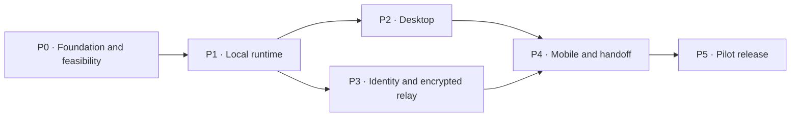

# MVP implementation roadmap

Version: 0.2 · 2026-11-21

## Definition of the first release

Deliver an installable internal pilot with desktop session tabs, a mobile terminal client, real workstation CLI execution, corporate identity, owner-only pairing, E2EE relay, reconnect, and explicit controller handoff. Follow [ARCHITECTURE.md](ARCHITECTURE.md) and [UI-SPEC.md](UI-SPEC.md).

Confirmed platform baseline: macOS desktop/host and iPhone mobile. The user selected Mac + iPhone first; Linux workstation/desktop and Android client implementations follow after the pilot. Pilot assumptions: Apple Silicon and a physical iPhone. Pin actual supported versions during P0. The corporate relay may be deployed on Linux; that is independent of workstation-platform support.

### Included

Workspace registration; CLI/environment readiness; create/list/rename/stop session; desktop tabs; mobile sessions/terminal; E2EE enrollment/pairing/revocation; one controller; reconnect and bounded history; installation and basic diagnostics; minimal metadata audit; manual signed release/update process.

### Deferred

Linux workstation/desktop support; Android client; structured agent chat/approvals/diffs; provider SDK integrations; automatic conversation resume; adopting arbitrary terminal sessions; shared access with colleagues; split panes; built-in editor/Git client; task scheduler; push notifications; file transfer; P2P; cloud execution; Windows; complete terminal recordings; automatic update infrastructure; enterprise MDM automation. Secure packaging and a documented manual update path are still required for the pilot.

## Milestones and dependencies



P2 and P3 may proceed in parallel once P1 contracts stabilize. Mobile layout work can use a fake adapter earlier, but P4 is complete only against real runtimes through the real relay. Do not let a visually complete app substitute for a working remote session.

## P0 — Establish the project and verify the foundation

**Goal:** resolve the few technical choices that could force a redesign.

Work:

1. Create the chosen project directory and a new repository when implementation begins. Import this planning package and design references. Configure CI and dependency locks. Repository hosting/name is an input, not an assumed existing checkout.
2. Establish minimal Go host/server and Tauri/React client scaffolds, plus versioned protocol fixtures. Preserve separate module ownership and avoid speculative frameworks/services.
3. Prove Claude Code and Codex rendering through ordinary tmux attach on macOS. Exercise alternate screen, Unicode, resize, terminal queries, and a second read-only viewer.
4. Prove the tmux service survives restart of the installed macOS host-agent service under the actual launch-service configuration. Verify runtime identity remains unchanged.
5. Run a physical iPhone terminal spike: keyboard/IME, paste, selection, scroll, resize, portrait/landscape, app suspend/foreground.
6. Select and pin interoperable Go/Rust E2EE implementations, concrete handshake pattern/suite, OS key-store adapters, and pairing transcript binding. Demonstrate an encrypted round trip using verified peer keys through an opaque relay harness.

Deliverables: runnable thin prototypes; repository skeleton; exact dependency/platform baseline; updated decision notes; interoperability fixtures; short feasibility report.

Exit gate: all four risk areas pass (terminal bridge, service persistence, phone input, E2EE/key storage), or a bounded component replacement is chosen and verified before dependent work. If the Tauri mobile shell fails usability, switch the mobile shell behind the existing contracts; do not quietly reduce required usability.

## P1 — Durable local sessions and host contracts

**Depends on:** P0.

Work:

- Build the user-level host agent, private local IPC, workspace registration, launch profiles, and startup diagnostics.
- Store sessions, runtime IDs, workspace mappings, operations, paired-device records, and state revisions locally.
- Manage a dedicated tmux service and namespace; implement create/list/rename/attach/detach/stop and exit tracking.
- Add one host-authoritative controller lease per runtime, fencing old input/resize owners.
- Implement attachment epochs, fresh-redraw reconnect, bounded queues/history, and recovery inventory.
- Prevent duplicate launches across request retries and agent crashes around process creation.

Verification: deterministic fake CLI for process/input assertions plus real Claude/Codex smoke tests; close/detach/reopen; kill/restart agent; shell/CLI exit; slow observer; two-client control race; independent session isolation.

Exit gate: same live runtime can be attached after UI and agent restarts; Stop affects only its target; stale owner input is rejected; local operation does not need the relay.

## P2 — Desktop application matching the approved concept

**Depends on:** P1.

Work:

- Build workspace/sidebar navigation, session tab bar, reordering, create-session dialog, rename, terminal view, controller banner, and connection/footer states.
- Connect the real host API through the native client bridge. Mount/unmount xterm views without changing runtime lifetime.
- Add onboarding/diagnostics, explicit Stop, exited/unreachable/locked states, local view persistence, and readable theme/font preferences.
- Keep CLI output within the terminal renderer. Limit native capabilities and sanitize application metadata.

Verification: UI-SPEC D1–D9; keyboard/focus behavior; desktop native WebView tests; no cross-tab input leakage; closing every tab while processes remain alive; reopen app with restored view preferences.

Exit gate: a developer can use the desktop app for a normal local Claude/Codex/shell workflow on the supported Mac target.

## P3 — Corporate access and encrypted relay

**Depends on:** P1 and P0 cryptographic gate.

Work:

- Build a single deployable Go server with OIDC, owner/host directory, short-lived routing authorization, revocation, and bounded WebSocket relay modules.
- Add PostgreSQL migrations and configuration for one corporate identity provider. Configure TLS and host-initiated tunnels.
- Implement real enrollment and independently verified QR pairing, endpoint key pinning, fresh per-connection E2EE, and reject unknown/changed/revoked keys.
- Carry all session-content operations inside E2EE. Central logs contain only the declared metadata allowlist.
- Authenticate local/remote commands at the host; server claims alone cannot create a trusted client key.
- Add relay restart and network-partition recovery; protocol compatibility and request-size limits.

Verification: two identities cannot access each other's hosts; key substitution and tampered frames fail; raw relay capture/logs contain no known prompt/path/output markers; replay/old-epoch input is rejected; revocation blocks connected clients and expires disconnected authorization according to the documented policy.

Exit gate: a second trusted client can create, attach, interact, and detach through the company server with authenticated E2EE. No test-only plaintext remote path is permitted in a release build.

## P4 — Mobile application, reconnect, and control handoff

**Depends on:** P2 and P3.

Work:

- Implement the approved mobile host/session list, terminal, keyboard accessory, new-session flow, pairing, and paired-device settings.
- Reuse session/domain contracts and terminal components while preserving phone-specific layouts.
- Implement Take control / Release control and desktop handoff UI, driven by host acknowledgment and lease epoch.
- Fit keyboard/safe-area changes and rotation; ensure a spectator cannot resize the owner's PTY.
- Reconnect after foregrounding or network switching; reset/redraw each new attachment; mark cached metadata stale while offline.
- Expose bounded plain-text history separately from the live terminal, without promising a full transcript.

Verification: UI-SPEC M1–M10 on a physical iPhone; repeat Wi-Fi/network changes, background/foreground, screen lock, desktop/mobile handoff, owner disconnection, and host sleep/wake. Verify a lost input acknowledgment never triggers automatic resubmission.

Exit gate: a user starts work on desktop, closes its window, continues the same live CLI from the phone, and returns control to desktop without duplicate input or state confusion.

## P5 — Installable internal pilot and release review

**Depends on:** P4.

Work:

- Produce signed/notarized macOS artifacts and an allowed signed iOS pilot distribution. Signing identities and release assets are independent of the relay's administrative trust. Linux workstation packages are deferred.
- Deliver self-hosted server configuration, deployment steps, database migration/backup instructions, and minimal health/metadata diagnostics.
- Document install, enrollment, pairing, recovery, device revocation, manual update, rollback, and safe uninstall that explicitly explains session termination.
- Verify update/restart boundaries using installed services. Runtime-engine upgrades can require a planned maintenance stop and must say so.
- Run the release matrix below and a focused review of pairing, authorization, cryptography integration, terminal/native bridge, and content logging.
- Pilot with a small internal cohort, record defects, and resolve release blockers.

Exit gate: all mandatory acceptance cases pass on the supported platform matrix; no unresolved critical/high-impact authorization, key-trust, input-duplication, or process-loss defects; install/recovery runbooks have been exercised by someone other than their author.

## Release acceptance matrix

| ID | Scenario | Required result |
|---|---|---|
| A01 | Create Claude/Codex/Shell on a registered workspace | Correct real executable, local configuration, separate runtime |
| A02 | Close desktop tab/window | Runtime survives and remains discoverable |
| A03 | Phone attach through corporate relay | Same runtime, usable live terminal, authenticated E2EE |
| A04 | Transfer control both ways | Exactly one accepted input/resize owner; stale epoch rejected |
| A05 | Phone background/network loss | Host task continues; reconnect redraws; input not auto-replayed |
| A06 | Host-agent and relay restarts | Live tmux runtime survives; inventory converges |
| A07 | Host sleep/reboot | Honest unreachable/ended state; no false progress or automatic command resurrection |
| A08 | Unauthorized user/device/key substitution | No session content or execution access |
| A09 | Inspect relay storage/logs/traffic payloads | No session-content plaintext or long-term private keys |
| A10 | Revoke device | Active access ends when notified; authorization expiry is bounded and documented |
| A11 | Slow client/high output | Bounded queues; CLI and other viewers keep progressing |
| A12 | Explicit Stop or natural CLI exit | Correct target/exit state; other sessions unaffected |
| A13 | Lost create reply / crash during create | No duplicate process from retry or recovery |
| A14 | Native install, upgrade, rollback | Supported user services and trust survive as documented |
| A15 | Ukrainian/English input, paste, terminal controls | Correct bytes and composition; no duplicate/lost user actions |

Initial measurement envelope: 20 online hosts, 10 retained sessions per host, and 40 concurrent viewed streams across the relay. This is a pilot test target, not a capacity claim. Phase 0 records test hardware, RTT and traffic shape, then pins queue budgets and measurable attach/reconnect/interaction latency criteria before release work. Require bounded memory and no cross-session interference regardless of chosen numeric targets.

## Suggested source structure when the repository is created

```text
remote-sessions/
  apps/client/                 # Tauri shell and React desktop/mobile entry layouts
  packages/ui/                 # shared application components and design tokens
  packages/terminal/           # xterm integration and mobile input adapter
  packages/session-client/     # typed transport-independent host API
  crates/client-core/          # native E2EE, pairing, connection lifecycle
  cmd/host-agent/              # Go host entrypoint
  cmd/server/                  # Go corporate server entrypoint
  internal/host/               # session service, ownership, tmux, platform adapters
  internal/server/             # identity, registry, relay, metadata audit
  internal/protocol/           # Go wire types and compatibility handling
  protocol/                   # canonical schema, fixtures, version policy
  tests/contract/              # cross-language protocol and crypto vectors
  tests/integration/           # runtime lifecycle and real relay failure tests
  deployment/                 # user services, server, packaging
  docs/                       # this baseline, ADRs, setup and operator runbooks
```

No separate microservice per folder. Generate or validate shared types from one protocol source. Keep optional future agent adapters outside the terminal engine rather than adding provider-specific conditions throughout the core.

## Estimates and sequencing guidance

These are planning ranges, not deadlines. They assume an experienced team, access to target devices, and available company identity/signing infrastructure.

| Phase | Engineering effort |
|---|---|
| P0 | 1–2 engineer-weeks |
| P1 | 2–3 engineer-weeks |
| P2 | 1.5–2.5 engineer-weeks |
| P3 | 2–4 engineer-weeks |
| P4 | 2–3 engineer-weeks |
| P5 | 1.5–3 engineer-weeks |

Total: approximately 10–17.5 engineer-weeks, excluding external review/distribution waiting time. This conservative planning envelope is retained for Mac + iPhone until P0 supplies implementation evidence. Elapsed time is not simply divided by team size because P0/P1 and integration gates are sequential. Re-estimate after P0. Linux workstation and Android port effort is excluded and will be estimated separately after the pilot.

## Post-pilot platform expansion

- Linux host/desktop: service-lifetime isolation with systemd user units, secure-store integration, distribution packaging, native WebView compatibility, and the same applicable release acceptance cases.
- Android: native key storage and pairing, keyboard/IME/selection, lifecycle/reconnect, signed distribution, and the same applicable mobile acceptance cases.
- Preserve platform interfaces now, but defer platform-specific code and CI release targets. Choose expansion order using pilot feedback.

Before each implementation phase: write its detailed execution plan from current evidence, assign acceptance cases, implement, run targeted verification, review, and capture results. No implementation phase is marked complete because its mockup or scaffold looks finished.
